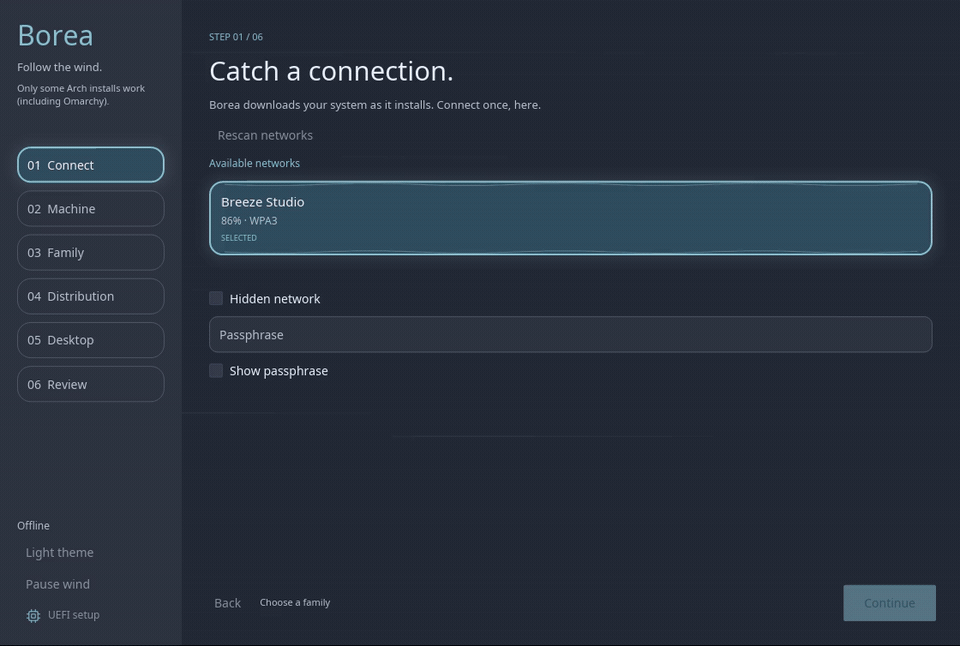
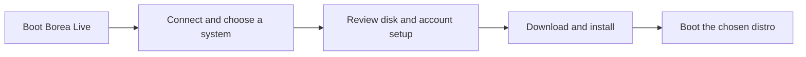

# Borea

[Overview](#overview) · [Status](#status) · [Try it](#try-it) · [Development](#development) · [Help out](#help-out) · [Docs](#docs)

[](https://shaddick-dev.github.io/borea-live/showcase/)

[Watch video](https://shaddick-dev.github.io/borea-live/showcase/) · [Download MP4](docs/assets/installer-showcase.mp4)

## Overview

Borea is an online Linux installer, aggregator and composer written in Rust.
The aim: one live USB for choosing and installing upstream distributions.

- Download the chosen system and apps when needed.
- Keep the distribution's own packages and updates.
- On Arch/CachyOS, prefer AUR apps; use official packages next and Flatpak as fallback.
- Choose the distribution, desktop and apps explicitly.
- Keep the live environment separate from the system being installed.

The full flow being built:



## Status

**Only some Arch installs work (including Omarchy). Other distro families are greyed out for now.**

- The live desktop has passed UEFI VM boot tests.
- Omarchy handoff opens its upstream installer; whole-disk and Windows-alongside paths have been tested in VMs.
- Base distro adapters are available through `borea-cli`; test coverage varies.
- Arch/CachyOS + Hyprland, niri or MangoWC + Noctalia v5 use the Iced disk/account flow. See [pathway status](docs/arch-noctalia.md).
- Target installations require UEFI. Secure Boot is optional.

| Family | Base backend | Other targets |
| --- | --- | --- |
| Arch | Arch rolling | CachyOS minimal integration; Omarchy upstream handoff |
| Fedora | Fedora stable | Bazzite and Nobara planned |
| Debian | Debian 13 | Butterbian and PikaOS planned |
| openSUSE | Tumbleweed | Desktop and package extras |

See the [current status](docs/STATUS.md), [backend verification](backend/docs/VERIFIED.md) and [live image verification](live/VERIFIED.md) for test results and gaps.

## Try it

On x86-64 Linux, install and open the USB helper:

```sh
curl -fsSL https://shaddick-dev.github.io/borea-live/install | sh
```

- Downloads the helper and latest published ISO; no local compilation.
- Asks you to type the USB device name before erasing it.
- Writes the image and verifies it by reading it back.

[USB helper guide](crates/borea-flash/README.md) · [Releases](https://github.com/shaddick-dev/borea-live/releases)

## Development

Use Rust 1.95+ for the workspace. Backend crates also support Rust 1.85.

```sh
cargo test --locked --workspace
cargo run -p borea-gui --bin borea-live -- --window
```

To compose an ISO locally, without a published release, use an x86-64 Linux host with Docker:

```sh
cargo run --locked --profile app -p borea-flash -- --compose
```

This uses prebuilt Linux components and compiles Borea's apps. First use takes longer; later runs reuse caches. [Composition guide](live/compose/README.md).

## Help out

- Connect the remaining GUI install paths to the backend.
- Add and test distro, desktop and app choices.
- Test USB boot, Wi-Fi, storage and installed systems on real hardware and in VMs.
- Improve the interface and software selection flow.

Start with an [issue](https://github.com/shaddick-dev/borea-live/issues) or a small PR. Bug reports should include hardware, distro, ISO version and logs. Use disposable disks for install tests.

## Docs

- [Iced interface](docs/iced-ui.md) — design, launch commands and captures.
- [Arch/CachyOS + Noctalia v5](docs/arch-noctalia.md)
- [Architecture](docs/architecture.md) — components and privilege boundaries.
- [Installer backend](backend/README.md) — plans, adapters and CLI usage.
- [Live environment](live/README.md) — boot, graphics and image builds.
- [Distribution scope](docs/distributions.md) — upstream sources and support policy.
- [Software selection](design/software-flow/README.md) — profiles and apps.
- [Roadmap](docs/roadmap.md) — planned work and acceptance checks.
